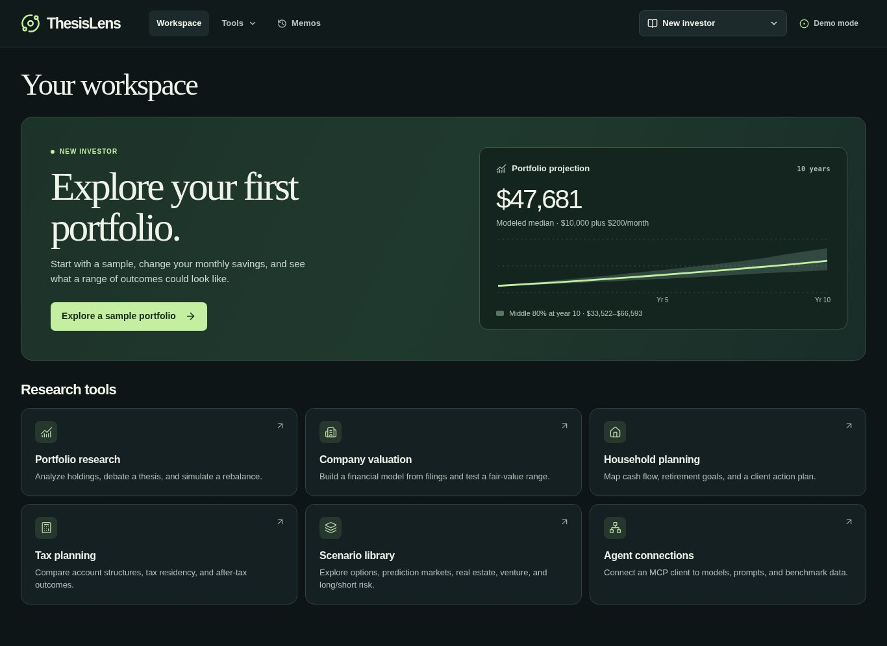

# ThesisLens

**An AI investment committee that argues before it advises, and checks its numbers with real math.**

Built for **Hack @ DevFest Sudbury 2026** (GDG Sudbury).



---

## The problem

Someone with a stock idea, a first portfolio or a rental-property deal usually has two options:

- **A spreadsheet.** Building a DCF or a stress test takes hours and real training.
- **A chatbot.** It answers in seconds, but language models are unreliable at arithmetic, and the answer is one confident voice with nobody arguing the other side.

Student investment clubs, new investors and small advisory practices sit in that gap.

## What ThesisLens does

You describe a thesis ("Sudbury nickel and AI grid power are a long-term trade"), add your holdings or an earnings slide, and ThesisLens convenes a committee of Gemini agents:

1. **An intake router** reads your inputs, including images and PDFs through Gemini's multimodal input, and decides which specialists the question needs.
2. **Specialists** (equity, options, real estate, venture, prediction markets, forensic accounting, risk) each run the relevant models.
3. **A Bull strategist and a Bear auditor** build opposing cases. They don't estimate numbers themselves. They call deterministic TypeScript tools through Gemini function calling (`run_dcf_valuation`, `run_monte_carlo_simulation`, `stress_test_cross_asset_shocks`, `analyze_portfolio_metrics` and others) and cite the results.
4. **A Chief Investment Officer** weighs the debate and returns a typed memo through Gemini structured output: a conviction score, a rating, catalysts, risks and a holding-by-holding rebalancing plan.

Every tool call, with its inputs and outputs, is visible in the app, so you can check how a conclusion was reached instead of taking it on trust.

> ThesisLens is a decision-support and learning tool, not financial advice.

## Why it matters here

Sudbury's economy runs on nickel, copper and the mining supply chain, and those are the assets that matter to a lot of people in the region. The scenario library includes **Sudbury Critical Minerals & AI Grid** (Vale, Cameco, Eaton, Alphabet, Canadian bonds) and **Sudbury Fourplex vs. REITs**, alongside general cases like a first portfolio, an options trade and a seed-stage SAFE.

## Demo (3 minutes)

1. **The problem (20s).** A spreadsheet takes hours. A chatbot guesses at the math. Neither argues with you.
2. **Run a committee (90s).** Open **Scenario library**, choose *Sudbury Critical Minerals & AI Grid* and select **Run analysis**.
   - In **Ask the committee**, open **Calculations** under the Bull and Bear turns to show the actual tool calls and returned values.
   - In **Scenario tests**, move the WACC and growth inputs and watch the valuation sensitivity grid update.
   - Compare a rate shock against a commodity supercycle in the stress tests.
3. **Multimodal and memo (40s).** Upload an earnings chart, show what the intake agent extracts, then **Save memo**.
4. **Close (30s).** Who it's for, what's built, and what comes next.

## How it's built

```
Thesis + holdings + chart / PDF
              │
              ▼
   Next.js streaming API (/api/analyze)
              │
   ┌──────────┴──────────────────────┐
   ▼                                 ▼
Deterministic quant engine      Gemini agents (@google/genai)
 • DCF + WACC sensitivity        • Intake router (multimodal)
 • Monte Carlo projections       • Routed specialists
 • Cross-asset stress tests      • Bull / Bear (function calling)
 • Beta, Sharpe, concentration   • CIO (structured JSON output)
   └──────────┬──────────────────────┘
              ▼
   Workspace UI (Recharts, live tool trace, saved memos in Firestore)
```

- **Gemini** (`gemini-2.5-flash` by default, override with `GEMINI_MODEL`): multimodal input, function calling and structured output.
- **Next.js, TypeScript, Recharts** for the app; **Firebase Firestore** for saved memos, with a localStorage fallback.
- **SEC EDGAR** fundamentals and a three-statement company model for real-company valuation (details below).
- **An MCP server** so other agents (Gemini CLI, Claude, Cursor and others) can use the same quant tools.

**Demo mode:** without an API key, the financial models still run for real and the committee's narrative is simulated. Add a free Gemini key to get the live committee.

## Quick start

```bash
npm install
cp .env.example .env.local
# Add a GEMINI_API_KEY from https://aistudio.google.com/apikey (optional; demo mode works without it)
npm run dev
```

Open [http://localhost:3000](http://localhost:3000), pick a profile in the header, then open **Tools** or **Scenario library**. The [workspace design system](docs/DESIGN_SYSTEM.md) describes the user journeys and components.

**Firestore (optional):** add your Firebase web SDK keys to `.env.local` (see `.env.example`) to sync saved memos to the `investment_memos` collection.

**Deploy:** see [`docs/GCP_DEPLOYMENT.md`](docs/GCP_DEPLOYMENT.md) for Cloud Run, or use `firebase deploy` for Firebase Hosting.

## What's next

- Test with a student investment club and see which parts they actually use.
- Add Canadian filings (SEDAR+) so TSX-listed miners get the same fundamentals as US filers.
- Backtest the committee's ratings against what actually happened ([`docs/VALUATION_MODELS_PLAN.md`](docs/VALUATION_MODELS_PLAN.md)).

---

# Technical reference

## Connect Any AI Agent (MCP Server)

ThesisLens ships with a **dual-transport Model Context Protocol (MCP) server** so other AI agents (Antigravity, Claude Desktop, Claude Code, Cursor, Gemini CLI, OpenAI Agents SDK, or custom web agents) can call its deterministic quant engine, compare competing capital options head-to-head, and run adversarial Bull vs. Bear pre-mortems.

- **19 Tools**: `get_company_fundamentals`, `build_company_model`, `run_company_analyst`, `run_dcf_valuation`, `run_monte_carlo_projection`, `analyze_portfolio_risk`, `simulate_rebalance`, `underwrite_real_estate_deal`, `compare_real_estate_markets`, `analyze_bond_duration`, `evaluate_prediction_bet`, `price_option_strategy`, `simulate_venture_powerlaw`, `run_forensic_accounting_audit`, `audit_global_tax_strategy`, `search_prediction_markets`, `query_intelligence_corpus`, `compare_decision_options`, and `run_adversarial_committee`.
- **3 Decision-Coaching Prompts**: `decision-brief`, `buy-vs-invest`, `probabilistic-bet-sizing`.
- **3 Read-Only Resources**: `thesislens://markets/real-estate`, `thesislens://tax/residencies`, `thesislens://scenarios/presets`.

### Option A: Local `stdio` MCP Server (Claude Desktop, Cursor, Antigravity, Gemini CLI)

Add this to your MCP client config (e.g. `claude_desktop_config.json`, `.cursor/mcp.json`, or Antigravity MCP config):

```json
{
  "mcpServers": {
    "thesislens": {
      "command": "npx",
      "args": ["tsx", "src/mcp/stdio.ts"],
      "cwd": "/ABSOLUTE/PATH/TO/thesislens",
      "env": {
        "GEMINI_API_KEY": "optional-for-live-gemini-committee"
      }
    }
  }
}
```

> All tools except `get_company_fundamentals` and `build_company_model` (which read SEC EDGAR) work **100% deterministically with zero API key**. Providing `GEMINI_API_KEY` automatically upgrades `run_adversarial_committee` to live Gemini multi-agent debate.

### Option B: Remote Streamable HTTP MCP Endpoint (`/api/mcp`)

When the Next.js app is running locally (`npm run dev`) or deployed, any HTTP-capable MCP client can connect to:

```text
POST http://localhost:3000/api/mcp
```

- Optional auth: set `MCP_API_KEY` in `.env.local` to require `Authorization: Bearer <MCP_API_KEY>`.
- Optional per-request Gemini upgrade: pass `x-gemini-api-key: <key>`.

## Company Fundamentals (SEC EDGAR)

> Roadmap, open decisions and known limitations: [`docs/VALUATION_MODELS_PLAN.md`](docs/VALUATION_MODELS_PLAN.md).

ThesisLens builds a normalized financial history for any SEC-reporting company directly from
XBRL filings: no API key and no paid data feed. It covers US 10-K/10-Q filers and foreign
20-F/40-F filers (IFRS, in the reporting currency).

```text
GET /api/fundamentals?ticker=AAPL[&asOf=2024-06-30][&annualPeriods=5][&quarterlyPeriods=8][&includeSources=1]
```

- **About 50 canonical line items** across the income statement, balance sheet, cash flow and bank-specific lines. Each has ordered fallback XBRL tags, so tag changes over time (e.g. ASC 606) don't break a series.
- **Discrete quarters.** 10-Qs report cash flows year-to-date, and Q4 is never filed, so ThesisLens derives Q2 = H1 − Q1 and Q4 = FY − 9M.
- **Point-in-time.** `asOf` hides every filing made after that date, including later restatements, so backtests can't see the future.
- **Provenance.** With `includeSources=1`, every value carries its XBRL tag, filing accession number, form, filing date and how it was derived.
- **Quality checks.** Balance-sheet identity (including mezzanine equity), quarters summing to the year, gross-profit tie-out, core coverage and freshness.
- **Sector templates.** Each company maps to one of 19 valuation templates from its SIC code plus curated overrides (`src/lib/fundamentals/sector.ts`).
- **Holding-company reorganizations.** History from a predecessor registrant is merged in (e.g. ExxonMobil, 2026).

Set `SEC_USER_AGENT` (the SEC requires an app name plus contact email). Responses are cached
under `SEC_CACHE_DIR` (default `.cache/sec`).

```bash
npm run verify:fundamentals                   # offline tests on real trimmed SEC fixtures (CI)
npm run audit:fundamentals                    # live audit of the ~280-company universe
npm run audit:fundamentals -- AAPL XOM --as-of 2024-06-30
```

If you run behind an HTTPS proxy, Node's built-in `fetch` only uses it with `NODE_USE_ENV_PROXY=1` (Node ≥ 22.21).

## Three-Statement Company Models & DCF

`build_company_model` (MCP) and `POST /api/model` turn a company's SEC history into a linked
income statement / balance sheet / cash-flow model and value it.

```bash
curl -X POST localhost:3000/api/model -H 'content-type: application/json' -d '{
  "ticker": "MSFT", "currentPrice": 480,
  "drivers":   { "revenueGrowth": [0.15, 0.13, 0.11], "ebitMargin": 0.46 },
  "rationale": { "revenueGrowth": "FY27 guide: low-to-mid teens (Q1 call)" },
  "detail": "full"
}'
```

| Layer | What it does |
|---|---|
| **Baseline** (`src/lib/model/baseline.ts`) | Derives every driver from reported history and records its basis. Year-1 growth and margin are anchored to reported year-to-date quarters. Growth fades to the terminal rate. Cyclical sectors fade margins to their through-cycle median. Sub-scale growth companies converge to a sector mature margin. Heavy capex fades to steady-state reinvestment (D&A + g × PP&E). |
| **Engine** (`engine.ts`) | Linked IS → CF → BS for 3–20 years. Cash is the only plug, with a revolver that draws below a cash floor and sweeps excess cash. The interest ↔ cash circularity is solved iteratively. Balance and cash-tie checks run every year. |
| **Valuation** (`valuation.ts`) | FCFF DCF with an exact stub period and mid-year discounting. CAPM WACC with relevered sector betas (market weights when `currentPrice` is given). Value-driver terminal value `NOPAT·(1 − g/RONIC)/(WACC − g)`. The bridge counts long-term marketable securities, minority and mezzanine equity. Outputs a 5×3 WACC × g sensitivity grid. |
| **Scenarios** | Bear / base / bull (±2pp growth fading out, ±2pp margin, ∓0.5pp WACC), probability-weighted. |
| **Overrides** | Any driver as a number or per-year path, plus financing and valuation inputs. Each override carries a rationale into the assumption notes. Unknown keys and out-of-range values are rejected. |
| **Templates** (`templates.ts`) | Per-sector beta, capital structure, terminal growth, RONIC spread, SBC treatment, cyclicality and mature margin. Banks, insurers and brokers are refused (they need residual-income models). REITs and utilities are marked indicative. |

```bash
npm run verify:model      # engine identities, closed-form DCF, value-driver economics, revolver, Apple end-to-end (CI)
npm run audit:models      # live: baseline model for every company in the universe, anomalies flagged
```

### Verification Scripts

```bash
npm run verify:quant   # Core quantitative engine invariants
npm run verify:mcp     # In-memory + real stdio MCP integration tests
npm run verify:fundamentals  # SEC XBRL normalization on real filing fixtures
npm run verify:model         # Three-statement engine + DCF invariants
```

## License

This project is licensed under the [MIT License](LICENSE).

> **Disclaimer:** ThesisLens is provided for educational, research, and informational purposes only and does not constitute financial, investment, tax, or legal advice.
