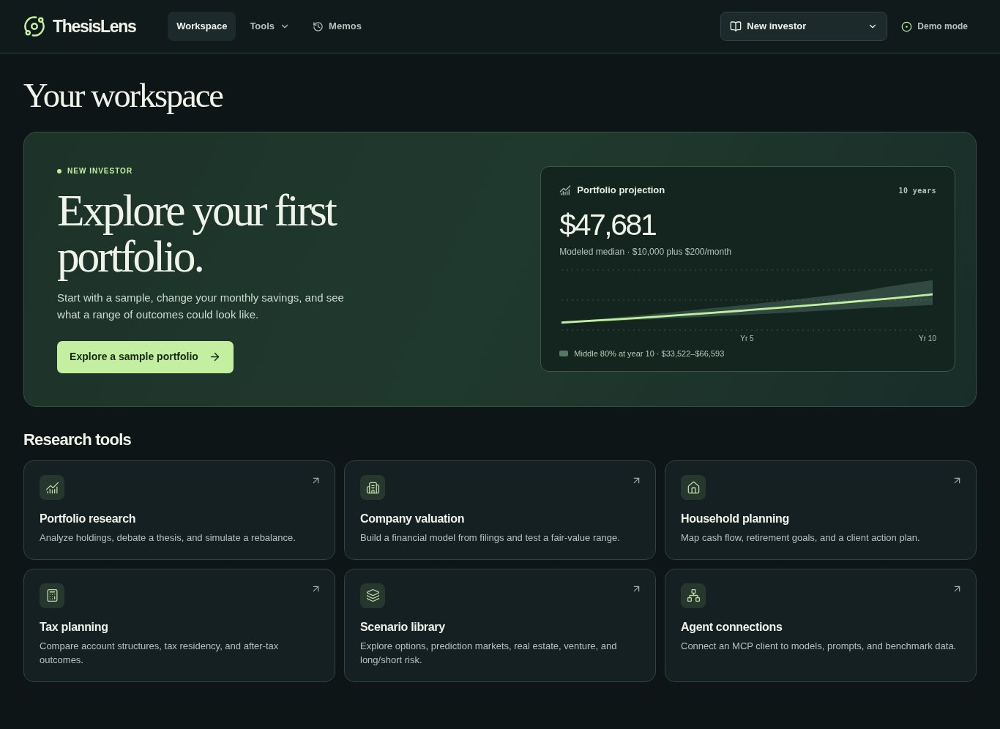

# ThesisLens workspace design

Every profile starts with a decision it can work through. The profile sets the suggested example, first tool, and language used to explain results. A user can switch profiles or open any workspace from Tools. Opening the workspace previews sample data. Running the committee and generating a client brief are explicit actions.

## What the review found

| Observed in the original app | Design change |
| --- | --- |
| Opening the home page immediately submitted a $100M long/short example. | Show a labeled sample and its assumptions. Let the user inspect or edit it before running an analysis. |
| At a 390 px viewport the document measured 663 px wide. The two experience controls disappeared below the small-screen breakpoint. | Keep the profile selector visible and move the same navigation to a second row on phones. |
| The scenario list, seven analysis modes, file upload, positions, and mandate all preceded the run action. | Lead with the question, capital, savings, and horizon. Group holdings/import and specialist inputs into expandable sections. |
| Editing a draft could pair new holdings with an earlier memo, chart, or follow-up. | Bind result views to the analyzed inputs. Flag edited inputs and offer a fresh run before applying a proposed allocation. |
| External-agent setup lived in the README, and its inventory count differed from the server. | Provide an in-app connection guide and use MCP discovery for the available tools, prompts, and resources. |

## Four starting paths

| Profile | First task | Result and next action |
| --- | --- | --- |
| New investor | Open the $10,000 sample. Change the $200 monthly contribution or the ten-year horizon. | Read the median and the middle 80% range in dollars. Ask what could go wrong. |
| Pro retail investor | Review the sector portfolio, import holdings, or open a company valuation. | Compare the bull and bear arguments, inspect sensitivity to assumptions, then simulate a rebalance. |
| CFP financial planner | Open the sample household, choose the client profile, and edit cash flow and milestones. | Review retirement and tax scenarios. Generate the client brief and export the report. |
| CFA hedge fund manager | Start with gross and net exposures in the long/short book. | Review liquidity, stress losses, and forensic checks in Scenario tests. Challenge the risk officer and inspect calculation inputs. |

The scenario library covers specialist workflows such as property underwriting, venture outcomes, options, and prediction markets. Choosing an example loads its inputs for review. Opening Portfolio research from Tools resumes the current draft.

## Interface foundations

| Token or pattern | Use |
| --- | --- |
| Canvas `#0D1516`, panel `#152022`, raised surface `#1C2A2B`, border `#334342` | Group related information with a surface and one outline. Use the raised tone for controls and selected navigation. |
| Primary text `#F0F3E9`, secondary text `#B3C1BB` | Use primary text for decisions, amounts, and headings. Use secondary text for assumptions, units, and provenance. |
| Action `#C4EFA0` on `#162814` text | Use one filled primary action per task. Pair risk colors with a label or signed value. |
| Display serif, interface sans serif, tabular numbers | Use the serif for workspace and starting-task titles. Use sans serif for controls and memo text. Use monospace for machine identifiers and tool inputs. |
| Spacing and shape | Use 8, 12, 16, and 24 px gaps within workflows. Use 14 px panel corners and a 44 px primary action. Stack previews above the tool list on phones. |
| Keyboard and motion | Provide a skip link, visible focus, native profile selection, and Escape dismissal for dialogs. Respect reduced motion. |

The implemented tokens and shared patterns live in [globals.css](../src/app/globals.css). Profile definitions and agent guidance live in [workspaces.ts](../src/lib/workspaces.ts).

## Agent interactions

**Inside the app.** A run starts with the user's current question and inputs. The activity view shows assigned specialists, their findings, and expandable calculations. A completed memo identifies its mode. A follow-up uses the analyzed portfolio, and each agent reply identifies Gemini or the deterministic engine. Applying a rebalance changes the draft portfolio.

**From an MCP client.** Open Agent connections and copy the endpoint or configure local stdio. Discover tools and reference data from the server. Start with the `decision-brief` prompt and optionally pass `audience` as `beginner`, `retail`, `planner`, or `manager`. The selected audience changes the explanation and questions. The financial inputs determine the calculation.

## Usability checks

Give each participant the first task for their profile. Observe whether they can identify the sample, change one assumption, find the downside, and explain where a result came from. For a planner, also check whether the exported brief reflects the edited household. For an agent client, check discovery, one calculation, and whether the returned brief communicates the relevant assumptions and source. These are proposed user tests.
