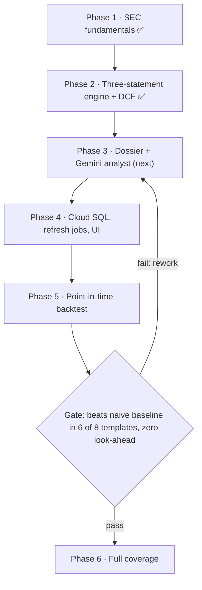

# Plan: Sell-Side-Grade Valuation Models for the Top 500 Stocks

**Goal:** ThesisLens automatically builds and maintains company valuation models comparable to
sell-side analyst models for the ~500 largest listed companies worldwide. That means linked
three-statement models driven by business drivers, anchored to guidance and consensus,
valued with sector-appropriate methods, and updated after every filing.

**Status (2026-11-22):** Phases 1 and 2 were completed on branch `claude/sleepy-johnson-9ngojn`;
Phases 3–6 are now implemented and verified offline on branch `feat/valuation-models-phases-3-6`
(`verify:analyst`, `verify:storage`, `verify:backtest`, `verify:sectors`). All decisions (D1–D4) are reflected.

---

## Guiding rules

1. **The LLM proposes assumptions and code computes everything.** Every number in a model comes
   from deterministic TypeScript. Every assumption must cite a source: a reported figure, a filing
   passage, guidance or consensus.
2. **Use data with as-of dates from day one.** Every value keeps the date its filing was made,
   so backtests can rebuild what was knowable at any past date.
3. **Don't break what exists.** `runDcfValuation`, the original MCP tools and the demo scenarios
   are untouched. The new engine sits alongside as new tools and routes.
4. **Follow the repo's test style.** Each phase adds a `scripts/verify-*.ts` check that runs
   offline in CI, plus a live `audit:*` script for the whole universe.

---

## Phase 1: data foundation (SEC EDGAR, free) ✅ Done

Commit `9f044a1`. Code in `src/lib/fundamentals/`.

- `sec-client.ts`: SEC EDGAR client. Paced at 8 req/s (the SEC limit is 10), cached on disk
  and in memory, serves a stale copy when SEC is unreachable, and sends a User-Agent from
  `SEC_USER_AGENT`.
- `line-items.ts`: about 50 standard line items (income statement, balance sheet, cash flow,
  bank lines). Each has ordered fallback tags in `us-gaap` and `ifrs-full`, plus sum and minus
  rules.
- `normalize.ts`:
  - Builds the fiscal calendar from period dates.
  - Derives single quarters from year-to-date figures (Q2 = H1 − Q1, Q4 = FY − 9M) and
    estimates Q4 diluted shares and EPS.
  - Applies the point-in-time `asOf` cutoff, so restatements stay hidden until they're filed.
  - Records where every value came from (tag, filing accession number, form, filing date,
    method).
- `checks.ts`: balance-sheet identity (including mezzanine equity), quarters summing to the
  year, gross-profit tie-out, core coverage and freshness.
- `sector.ts`: maps each company to one of 19 sector templates from its SIC code plus curated
  overrides.
- `universe.ts`: a hand-maintained seed list of about 280 large SEC filers. It supports merging
  a predecessor company's history after a holding-company reorganization (ExxonMobil, 2026).
- Interfaces: `GET /api/fundamentals` and the `get_company_fundamentals` MCP tool.
- Tests: `npm run verify:fundamentals` (CI, real trimmed filings) and
  `npm run audit:fundamentals` (live).

**Result:** all 278 companies load, mean core coverage is 96.5%, and 266 pass every data check.
The rest are flagged because their source data really is inconsistent.

## Phase 2: three-statement engine, templates and valuation ✅ Done

Commit `f41e1ca`. Code in `src/lib/model/`.

- `baseline.ts`: sets every driver from the company's own history and records its basis.
  - Year 1 is anchored to the quarters already reported this fiscal year.
  - Growth fades to the terminal rate.
  - Cyclical sectors fade margins toward their through-cycle median.
  - Sub-scale growth companies converge to a sector mature margin.
  - Heavy capex fades to a steady state (D&A + g × PP&E).
- `engine.ts`: linked income statement → cash flow → balance sheet for 3–20 years.
  - Cash is the only plug. A revolver draws when cash would fall below a floor and is paid
    down with excess cash.
  - The interest ↔ cash circularity is solved iteratively.
- `valuation.ts`: FCFF DCF.
  - CAPM WACC with relevered sector betas, using market-value weights when a price is supplied.
  - Exact stub period and mid-year discounting.
  - Value-driver terminal value: NOPAT·(1 − g/RONIC)/(WACC − g).
  - The EV-to-equity bridge deducts net debt (net of cash and long-term marketable securities),
    minority interest and mezzanine equity.
  - WACC × terminal-growth sensitivity grid.
- `templates.ts`: per-sector settings: beta, target capital structure, terminal growth, RONIC
  spread, SBC treatment, cyclicality and mature margin.
- Bear/base/bull scenarios, a probability-weighted value and an 8-quarter outlook.
- Overrides: any driver as a number or per-year path, with a rationale. Unknown keys and
  out-of-range values are rejected.
- Interfaces: `POST /api/model` and the `build_company_model` MCP tool (18 MCP tools total).
- Tests: `npm run verify:model` (CI) covers engine identities, the closed-form DCF,
  value-driver economics, the revolver, an Apple end-to-end model and point-in-time.
  `npm run audit:models` (live) sweeps the whole universe.

**Result:** 231 of the 278 companies get a model. The 46 financials are refused by design, and
one company lacks share data. Every model balances and its cash ties out.

---

## Roadmap at a glance



Phase 4's schema and migrations can start alongside Phase 3; its filing poller needs the Phase 3
analyst. The Phase 5 backtest is the one hard gate.

## Phase 3: company dossier and Gemini analyst ⏳ Next

Turns the mechanical baseline into an analyst view: Gemini reads guidance, call commentary and
filing text, then writes cited overrides that the Phase 2 engine computes.

**3a. Provider interfaces (D1, D4)**

- `FundamentalsProvider`: wraps today's SEC client as the first implementation.
- `RatesProvider`: the FRED 10-year Treasury replaces the fixed 4.25% risk-free rate; Damodaran's
  implied ERP replaces the fixed 4.5%.
- `MarketDataProvider`: prices, betas and market caps. Free default = price passed in by the caller.
- `ConsensusProvider`: interface only; no free implementation.
- `AnalystModel`: structured output plus tool calls. Gemini (`@google/genai`, `GEMINI_MODEL`) is
  the default; other providers are adapters selected by `ANALYST_PROVIDER`.

**3b. Company dossier** (`src/lib/dossier/`)

- A compact pack per company, about 20–40k tokens: history as CSV, segment and KPI history, a
  dated guidance log, the prior model's assumptions, and the filing passages relevant to each driver.
- Segments and KPIs come from the SEC Financial Statement & Notes datasets; LLM extraction from
  10-K/10-Q text fills gaps. Segments must sum to reported totals or are rejected.
- Guidance comes from earnings press releases (8-K exhibit 99.1), each entry dated and linked to
  its filing.
- Filing text is split into sections (MD&A, segment notes, risk factors) so the analyst fetches
  only what a driver needs.

**3c. Analyst loop** (`src/lib/analyst/`)

1. Load the dossier and the baseline model.
2. Gemini proposes overrides in the Phase 2 schema, each citing a dossier passage.
3. It can call `get_filing_section`, `get_kpi_history`, `get_guidance` and `run_model` to check the
   result and revise.
4. A validator rejects uncited assumptions or ones outside sector bounds, and flags any that differ
   from guidance without a stated reason.
5. The final model, notes and citations are returned; nothing is stored yet (Phase 4).

**3d. Cost control**

- Sector instructions, the template schema and worked examples form a shared, cached prompt
  prefix; each company adds only its own pack.
- Full-universe runs use batch requests.

**Interfaces:** `POST /api/model` gains `analyst: true`; a new MCP tool `run_company_analyst`.

**Done when:**

- [ ] Every override in an analyst model carries a resolvable citation.
- [ ] 20 reference companies run end to end with zero validator rejections on the final pass.
- [ ] FRED rates replace the fixed defaults, with the as-of date recorded.
- [ ] Offline `verify:analyst` runs against recorded model responses (no API key in CI).

## Phase 4: storage, refresh jobs and UI

Makes models persistent and self-updating: Postgres on Cloud SQL (D3) holds versioned models, and
Cloud Run Jobs re-model a company whenever it files.

**Schema** (migrations in the repo; pgvector for filing text)

| Table | Holds |
|---|---|
| `companies` | Ticker, CIK, predecessor CIKs, template, currency, universe membership |
| `facts` | Normalized line items per period, with tag, accession number and filing date |
| `kpis` | Segment and operating KPIs per period, with source |
| `guidance` | Dated guidance items linked to their filing |
| `doc_chunks` | Filing and release text sections, with embeddings |
| `model_versions` | Assumptions, notes, outputs and citations per model run; one row per version |
| `runs` | Job runs: trigger, duration, token cost, errors |

**Jobs** (Cloud Run Jobs; Cloud SQL connector)

- Nightly: refresh SEC facts for the whole universe, rebuild baseline models.
- Filing poller: watch the EDGAR feed; on a new 10-K, 10-Q, 20-F or earnings 8-K, re-run the
  analyst for that company only, with a "what changed since the last model" prompt.
- The file cache stays as the raw SEC response cache.

**UI: Company Model tab**

- Statement grid (history plus forecast) with each driver's value and citation.
- Bear/base/bull toggle, the sensitivity grid and price-target history across model versions.
- The existing IC committee receives the full model as input.

**Done when:**

- [ ] A new filing triggers a new model version within one hour, with no manual step.
- [ ] Any model version can be reopened with its exact inputs and citations.
- [ ] The UI shows the full statement grid and assumption notes for any covered ticker.

## Phase 5: backtesting and the expansion gate

Coverage doesn't expand until analyst models forecast next-quarter results better than a naive
baseline, measured without look-ahead.

**Method**

1. Pick 50 companies across at least 8 templates.
2. For each of the last 8 quarters, rebuild the dossier and model as of the day before that
   quarter's earnings release, using the Phase 1 `asOf` cutoff. Filing text is filtered by the
   same date.
3. Compare the model's next-quarter revenue and diluted EPS with the reported figures.
4. Score three forecasters on the same quarters: the Phase 2 baseline, the Phase 3 analyst, and a
   naive seasonal baseline (same quarter last year × trailing growth).

**Metrics**

- Median absolute percentage error (revenue, EPS), overall and by template.
- Directional hit rate versus the prior-year quarter.
- Share of citations that resolve to a passage filed before the as-of date (look-ahead audit;
  must be 100%).
- Against analyst consensus only once a paid `ConsensusProvider` is added (optional under D1).

**Gate**

- [ ] Analyst beats the naive baseline on median revenue error in at least 6 of 8 templates.
- [ ] Analyst beats the Phase 2 baseline on median EPS error overall.
- [ ] Look-ahead audit at 100%.

A failed gate sends the work back to Phase 3 prompts, dossier content or template defaults, not
forward to Phase 6.

## Phase 6: full coverage

Closes the gaps the FCFF engine can't cover: financials, specialist sectors and companies outside
SEC filings.

**Sector models**

| Sector | Method | Replaces today's |
|---|---|---|
| Banks | Residual income; price to tangible book vs ROTE | Refused |
| Insurers | Embedded value / ROE-based | Refused |
| Brokers, asset managers | Fee-earning AUM or balance-sheet-light ROE | Refused |
| REITs | NAV plus AFFO multiple | Indicative DCF |
| Utilities | Rate base × allowed ROE | Indicative DCF |
| Oil & gas, mining | Commodity price deck; reserve NAV | Cyclical-fade DCF |
| Pharma & biotech | Risk-adjusted NPV by pipeline asset | Portfolio-trajectory DCF |
| Autos | Separate captive-finance debt from industrial | DCF with finance debt included |

**Data beyond the SEC**

- EU filers via ESEF iXBRL (filings.xbrl.org); Japan via the EDINET API.
- Other markets through a paid `FundamentalsProvider` adapter (D1).
- ADR handling: price conversion and ADR ratios, so per-share values compare with the listed price.

**Paid provider adapters (optional, D1)**

- `MarketDataProvider`: live prices, regression betas, market caps. Enables a true top-500 ranking.
- `ConsensusProvider`: Street estimates for the Phase 5 comparison and for flagging where the model
  differs from consensus.

**Done when:**

- [ ] Every top-500 company gets a model from an appropriate method (none refused).
- [ ] The universe is ranked by market cap from a provider, not a hand-kept list.
- [ ] Each new sector model passes its own `verify:*` test and a Phase 5 backtest.

## Risks

| Risk | Effect | Mitigation |
|---|---|---|
| Gemini cites passages that don't support the number | Plausible but wrong assumptions | Validator checks every citation resolves; Phase 5 audits it |
| Guidance filed after the as-of date leaks into backtests | Backtest looks better than reality | Filter dossier text by filing date; 100% look-ahead audit |
| SEC XBRL lags for some foreign filers (TSM, Toyota stop at FY2024) | Stale models | Freshness check flags them; Phase 6 data sources |
| Free data has no live prices or consensus | Upside needs a hand-entered price; no Street comparison | Provider interfaces ready for paid adapters (D1) |
| LLM cost on a full-universe refresh | Budget overrun | Cached shared prefix, batch requests, re-model only on new filings |

## Open questions

- [ ] Which 20 reference companies anchor Phase 3 testing?
- [ ] Monthly LLM budget for nightly and filing-triggered runs?
- [ ] Is the Company Model tab internal only, or shown to all ThesisLens users?

---

## Decisions

All four were decided by the project owner on 2026-11-22.

| # | Decision | Choice | What it means for the build |
|---|---|---|---|
| D1 | **Data budget** | **Free sources only for now, built so paid providers can plug in later.** | Data comes from SEC EDGAR, FRED and Damodaran. Every external input goes behind a provider interface with a free implementation, so a paid vendor (FMP, EODHD, FactSet, LSEG, Visible Alpha) is a new adapter, not a rewrite. The interfaces: `FundamentalsProvider` (SEC today), `MarketDataProvider` (prices, betas, market caps; until a feed is added, the caller passes the price by hand), `RatesProvider` (risk-free rate and ERP; fixed defaults today, FRED next), `ConsensusProvider` (none today). Phase 5 compares against a naive seasonal baseline until a consensus provider exists. |
| D2 | **SEC contact string** | **App name "ThesisLens" plus the owner's contact email.** | The code reads it from `SEC_USER_AGENT`, and the value is kept out of the repo. Set it in `.env.local` for local runs, and as the GitHub repository variable `SEC_USER_AGENT` for Cloud Run (`deploy-gcp.yml` passes it through, along with `SEC_CACHE_DIR=/tmp/sec`). |
| D3 | **Storage** | **Postgres on Cloud SQL with pgvector.** | Phase 4 adds the schema (`companies`, `facts`, `kpis`, `guidance`, `doc_chunks` with embeddings, `model_versions`, `runs`) and migrations. Cloud Run connects through the Cloud SQL connector. The file cache stays as the SEC response cache. |
| D4 | **LLM for the analyst** | **Gemini by default, with other providers as options.** | Phase 3 defines an `AnalystModel` interface (structured output plus tool calls). The default implementation uses `@google/genai` and `GEMINI_MODEL`. Other providers (e.g. Claude, OpenAI) are separate adapters chosen by an `ANALYST_PROVIDER` env var. Nothing outside the adapter depends on the provider. |

## Known limitations (as of Phase 2)

- **Baseline values are opinion-free.** They aren't sell-side quality until Phase 3 adds
  guidance and analyst judgement.
- **Cyclicals at peak:** revenue isn't mean-reverted. The model flags these cases
  (e.g. Micron 2026).
- **Banks, insurers and brokers** are refused until Phase 6. **Utilities and REITs** are
  marked indicative only.
- **Auto captive-finance debt** (Ford Credit, GM Financial) is counted as industrial debt.
- **Foreign filers:** values are in the reporting currency, and ADR prices and ratios aren't
  converted.
- **SEC data gaps:**
  - TSM and Toyota stop at FY2024 because the SEC hasn't processed their latest 20-Fs yet.
  - Some companies tag EPS and share counts only by share class (e.g. V, BRK), which the
    companyfacts feed doesn't include.
  - Some utilities report capex only in company-specific tags, so it's estimated from the PP&E
    roll-forward.

## Running it

```bash
npm run verify:fundamentals && npm run verify:model     # offline, in CI
npm run audit:fundamentals                              # live data audit (~280 companies)
npm run audit:models                                    # live baseline model sweep
# Behind an HTTPS proxy, Node's fetch needs NODE_USE_ENV_PROXY=1 (Node >= 22.21)
```
